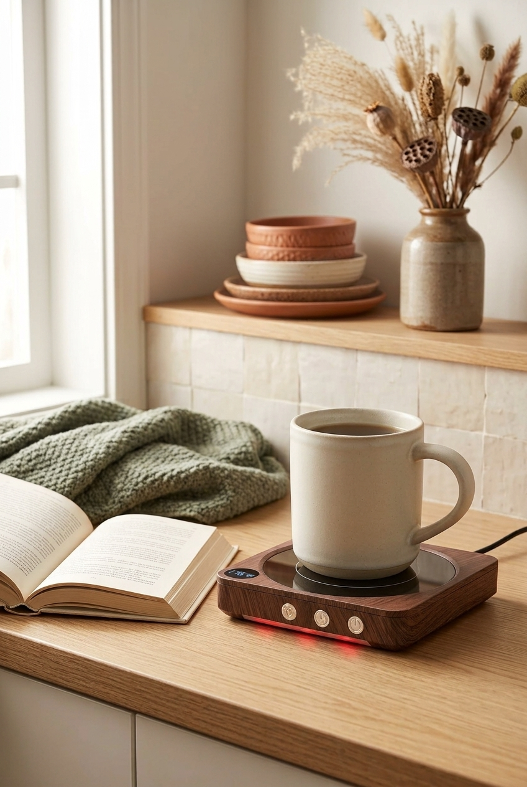
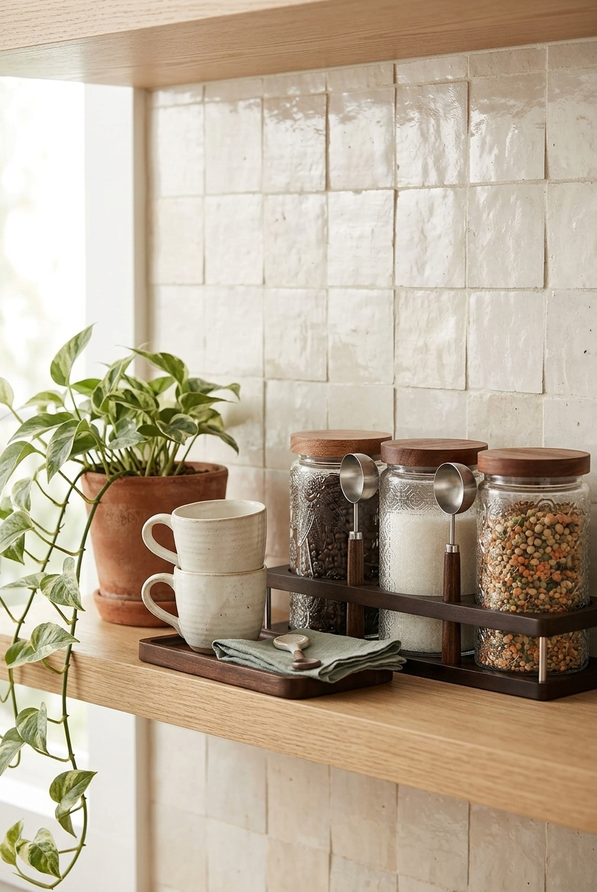

Buying for a coffee lover gets harder the more they love coffee. They already have the machine, probably a grinder, and a favourite mug they will not give up. Another gadget is a gamble, and a bigger machine needs counter space they do not have. The gifts that work for this person are the ones around the cup: things they would enjoy every morning but never think to buy for themselves. Everything here is small, and it is sorted by the kind of coffee person you are buying for.

This post contains affiliate links. If you buy through one of them I may earn a small commission, at no extra cost to you. As an Amazon Associate I earn from qualifying purchases.

## The short version

- **For the latte person:** [double wall glass mugs](https://www.amazon.com/dp/B09WTTTW2N?tag=hemidal-20)
- **For the one with a mismatched mug pile:** [four mugs that stack](https://www.amazon.com/dp/B0CKXHL48V?tag=hemidal-20)
- **For a slower weekend cup:** [a ceramic pour over dripper](https://www.amazon.com/dp/B000P4D5HG?tag=hemidal-20)
- **For the one who carries coffee from room to room:** [an insulated mug with a handle and lid](https://www.amazon.com/dp/B085BJ4MLK?tag=hemidal-20)
- **For the one whose coffee goes cold at the desk:** [a mug warmer](https://amzn.to/3SDQBCI)
- **For the one who buys good beans:** [glass jars with bamboo lids](https://amzn.to/4zUbjiz)

The reasoning for each, and who should not get it, is below.

## Upgrade the cup, not the machine

Someone who loves coffee has usually chosen their machine already, and chosen it carefully. Replacing it or adding to it is the riskiest gift there is. The cup, a second way to brew, the way the coffee stays warm: those are the parts they rarely upgrade, because each one feels like an indulgence. That is exactly what makes them good gifts.

## For the latte person

### Double wall glass mugs

Two clear glass mugs with a second wall inside, shaped like a classic diner mug. In a glass mug you can see the layers of a latte, which turns an ordinary weekday coffee into something worth looking at. The double wall also means the outside does not get as hot in the hand as a single layer of glass would.

The set I link to holds about 13.5 ounces per mug, a proper latte size. The trade-off is that glass is more fragile than stoneware, so these suit someone careful with their things. And a set of two is a gift for one person or a couple, not for a whole household.

[Check the glass mugs on Amazon](https://www.amazon.com/dp/B09WTTTW2N?tag=hemidal-20)

## For the one with a mismatched mug pile

### Four mugs that stack

A set of mugs is a good gift only when it replaces mugs instead of adding to them. Four that stack let someone box the mismatched pile they have been meaning to sort, and keep a working set that takes the shelf footprint of a single mug.

The set I link to is four 15 ounce mugs in off-white, each with a different texture and a speckled rim, so they look collected rather than matched. Ordinary mugs piled inside each other chip and wedge. These are shaped to stack.

Not for someone attached to their own mugs. If they have a favourite they use every day, a new set will sit in the cupboard next to it.

[Check the stackable mugs on Amazon](https://www.amazon.com/dp/B0CKXHL48V?tag=hemidal-20)

## For a slower weekend cup

### A ceramic pour over dripper

For someone with a machine for weekdays, a pour over dripper is a second way to make coffee on slow mornings. It sits on top of a mug or a small jug, holds a paper filter, and makes one to four cups depending on how much water you pour through. It takes no counter space at all, because it lives in a cupboard between uses.

The one I link to is the classic ceramic cone, size 02. Two things to add before you wrap it: a pack of size 02 paper filters, which it needs, and ideally a bag of good beans. It works with any kettle if they pour slowly, and better with a gooseneck one.

Ceramic holds heat well once it is warmed with hot water, but it breaks if dropped. For someone who is clumsy before their first coffee, that is worth knowing.

[Check the pour over dripper on Amazon](https://www.amazon.com/dp/B000P4D5HG?tag=hemidal-20)

## For the one who carries coffee from room to room

### An insulated mug with a handle and lid

Some people make a coffee and then walk around with it: to the desk, to the balcony, to wherever the laptop is. An insulated mug keeps it hot far longer than a ceramic one, and a handle makes it feel like a mug rather than a travel cup.

The one I link to is 12 ounces, navy, with a clear sliding lid. The lid is spill resistant, not leak proof. It is for walking around the house or sitting at a desk, not for throwing in a bag.

[Check the insulated mug on Amazon](https://www.amazon.com/dp/B085BJ4MLK?tag=hemidal-20)

## For the one whose coffee goes cold at the desk

### A mug warmer

For the person who makes a cup, answers one email, and finds it cold an hour later. A small plate under the mug keeps the drink warm for hours. It is the gift I recommend most for coffee lovers in general, and it works just as well for someone who already has everything, because almost nobody buys one for themselves.

It works properly only with flat bottomed mugs, and most models switch off on their own after a few hours.

[Check the mug warmer on Amazon](https://amzn.to/3SDQBCI)

## For the one who buys good beans

### Glass jars with bamboo lids

People who buy good beans often keep them in the bag they came in, folded over with a clip. Sealed glass jars keep the beans fresher and look better on a shelf. Fill one with beans from a local roaster before you wrap it, and the gift becomes personal.

Glass is heavy and shows fingerprints, which is the only real downside.

[Check the glass jars on Amazon](https://amzn.to/4zUbjiz)

## What I would skip

**Anything that duplicates their machine.** If their espresso machine already steams milk, a frother is a drawer of guilt.

**Pre-ground coffee in a gift tin.** Ground coffee goes stale quickly, and the grind may not suit how they brew. Whole beans from a local roaster are the better version of this gift.

**Slogan mugs.** One laugh, then the back of the cupboard. Someone who has everything has plenty of those already.

**A second machine.** Even a small one needs counter space you have not measured.

## FAQ

**What do you get a coffee lover who has everything?**

Something around the cup rather than the machine: better mugs, a second way to brew on slow mornings, or a way to keep coffee warm. These are the upgrades people enjoy every day and rarely buy for themselves.

**Is a pour over dripper a good gift for someone with a coffee machine?**

Yes, if they enjoy slow weekend mornings. It is a different kind of coffee rather than a replacement, and it stores in a cupboard. Add a pack of filters in the right size, because it does not work without them.

**Are double wall glass mugs worth it?**

For latte and cappuccino drinkers, yes. Seeing the layers is half the point, and the outer wall stays more comfortable to hold than single glass. For someone who drinks black coffee from a large mug, a good ceramic mug is the better choice.

**How do I make a small coffee gift feel bigger?**

Pair it with something they will use up. Glass mugs with a bag of beans, a dripper with filters and beans, or a jar filled with coffee from a local roaster. The object is useful, the coffee is personal, and together they feel like more than either one.

## If you only buy one

Get the double wall glass mugs. They work with every machine and every way of making coffee, they make an ordinary morning feel a little special, and they are something a person who has everything almost never owns. If you know they drink their coffee black and slowly, get the mug warmer instead.

More for the season: [Christmas coffee bar ideas for a small apartment](/blog/christmas-coffee-bar-small-apartment/), and the first gift guide, [coffee lover gift ideas that fit a small kitchen](/blog/coffee-lover-gift-ideas-small-kitchens/).
