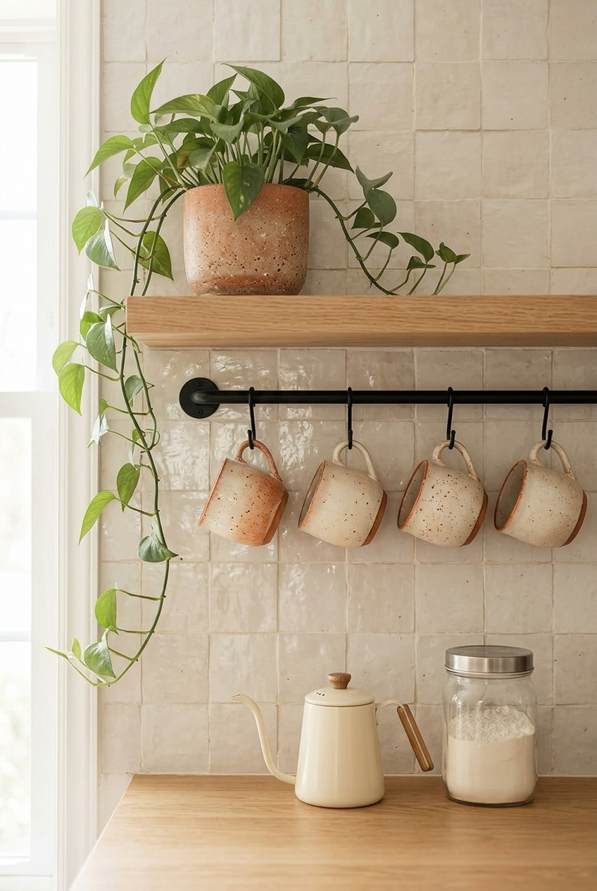
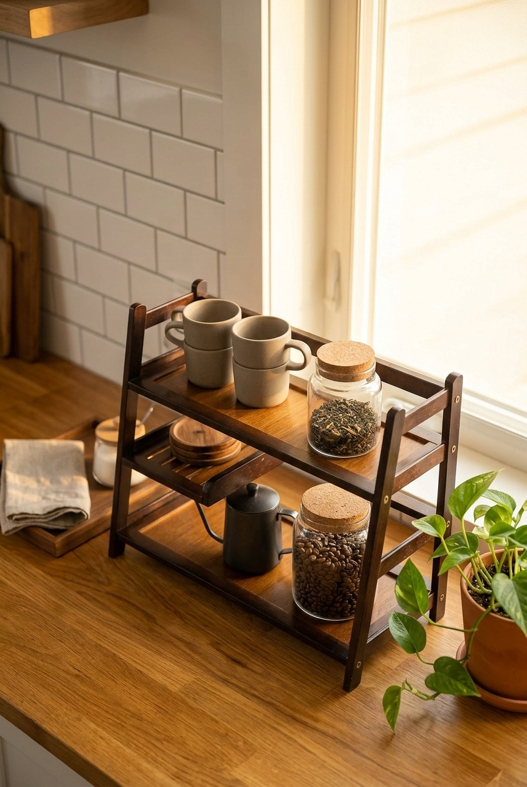
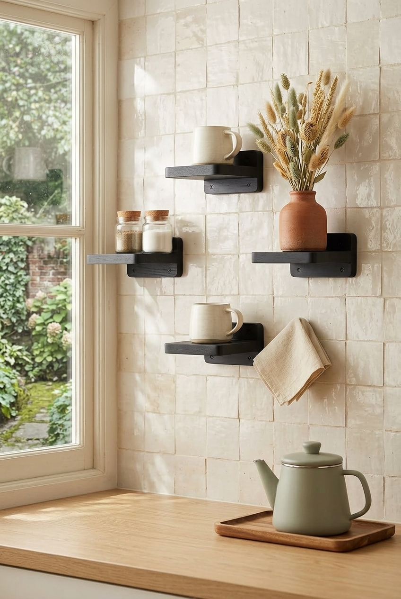

The first month in a small apartment has the same problems every time. The mugs do not fit in the one cabinet. The counter disappears under a kettle, a toaster and a fruit bowl. Half the kitchen is still in a box because there is nowhere to put it. The best housewarming gifts solve one of those problems. Everything here is either freestanding or renter friendly, and it is sorted by the problem it solves.

This post contains affiliate links. If you buy through one of them I may earn a small commission, at no extra cost to you. As an Amazon Associate I earn from qualifying purchases.

## The short version

- **When the mugs do not fit:** [a wall mounted mug rail](https://amzn.to/4i9oFB7)
- **When the counter is full:** [a three tier bamboo organizer](https://amzn.to/4xyiBH8)
- **When they can mount a shelf:** [narrow floating shelves](https://amzn.to/4gOrJAm)
- **For the pantry, from day one:** [glass jars with bamboo lids](https://amzn.to/4zUbjiz)
- **For the first slow morning:** [a french press](https://amzn.to/4zUbpGX)
- **For working from the new place:** [a mug warmer](https://amzn.to/3SDQBCI)

## Ask one question first

Can they put anything on the walls?

Some renters can drill small holes and fill them when they leave. Some are not allowed to touch the walls at all. Some have textured or matte painted walls where adhesive will not hold. The answer decides whether the first three gifts on this list are useful or a problem, so it is worth asking, even if it spoils the surprise a little.

If you cannot ask, stick to the freestanding gifts: the organizer, the jars, the french press and the mug warmer.

## Storage that solves the first week

### A wall mounted mug rail

Mugs are the item that breaks a small kitchen. They are bulky, they do not stack well, and they take a whole cabinet shelf. Hanging four of them on a rail gives that shelf back on the first day.

Only for someone who can mount it. Check whether their wall takes screws or needs an adhesive version, and remember that adhesive fails across tile grout lines and on textured walls.

[Check the current listing on Amazon](https://amzn.to/4i9oFB7)

### A three tier bamboo organizer

Two extra levels of storage on the same patch of counter, with nothing attached to the wall. It works for coffee things, spices or the small items that have no home yet, and it moves with them to the next place.

The one thing to check is height. If it is going under wall cabinets, it has to fit underneath with room to lift things off the top tier. A stand that does not fit is a return, so this is a gift for someone whose kitchen you have seen.

The trade-off: it is also a new surface for clutter to collect on. It works for tidy people and becomes a pile for everyone else.

[Check the current listing on Amazon](https://amzn.to/4xyiBH8)

### Narrow floating shelves

A shelf four to six inches deep holds mugs, jars and a small plant without eating into the counter. Anything deeper starts collecting things at the back where nobody can see them.

This is the least renter friendly gift here, because a floating shelf needs a solid mount to carry real weight. Give it to someone who owns their place or has permission to drill, and check the weight rating against what they are likely to put on it.

[Check the current listing on Amazon](https://amzn.to/4gOrJAm)

### Glass jars with bamboo lids

The pantry in a new apartment starts as a row of opened bags with clips. Two or three sealed jars for coffee, sugar or pasta make the shelf look settled long before the rest of the place does.

No measuring, no drilling and no guessing about their kitchen. Glass is heavy and shows fingerprints, which is the only real downside.

[Check the current listing on Amazon](https://amzn.to/4zUbjiz)

## For the first slow morning

### A french press

The coffee machine is often the last thing unpacked, or the thing they have not bought yet. A french press makes good coffee with nothing but hot water, stores in a cupboard, and does not commit them to a machine before they know how the new kitchen works.

The cost is four minutes of steeping and a plunger of wet grounds to clean. Fine for weekends, annoying for someone who leaves the house at seven.

[Check the current listing on Amazon](https://amzn.to/4zUbpGX)

### A mug warmer

For the person who will be working from the new place. A small plate keeps a mug warm for hours on a desk, which matters more than it sounds when the desk is a corner of the kitchen table.

It only works well with flat bottomed mugs. Most models switch off on their own after a few hours.

[Check the current listing on Amazon](https://amzn.to/3SDQBCI)

## What I would skip as a housewarming gift

**Decor with words on it.** "Home sweet home" signs and word art are a taste you cannot predict, and a small apartment has no spare wall for something they did not choose.

**Large appliances.** An air fryer or a stand mixer needs counter space you have not measured and they may not have.

**Anything wall mounted for someone who cannot drill.** A gift that needs a landlord conversation, or that takes paint off the wall when they move out, is a gift with a cost attached.

**A big matching set.** Twelve canisters or a full knife block assume a kitchen twice the size. Two good pieces beat a set they have nowhere to put.

## FAQ

**What is a good housewarming gift for a small apartment?**

Something that adds storage without adding clutter, or something they will use up. Glass jars, a freestanding organizer or a mug rail solve real first-week problems. A bag of good coffee in one of those jars is hard to get wrong.

**Is it rude to ask about the kitchen before buying a gift?**

No. Asking whether they can put things on the walls, or how much counter space they have, shows you want the gift to be useful. Most people would rather lose the surprise than find space for something that does not fit.

**What should I not give someone who rents?**

Anything that needs drilling without permission, heavy items that rely on adhesive, and large decor they have to find wall space for. Renters move, so gifts that pack flat and move easily are the ones that last.

## If you only buy one

Get the glass jars, and fill one with coffee from a local roaster before you wrap it. There is nothing to measure, nothing to mount and nothing that can go wrong in a kitchen you have never seen. It is useful from the first morning, and it looks like you thought about it, because you did.
